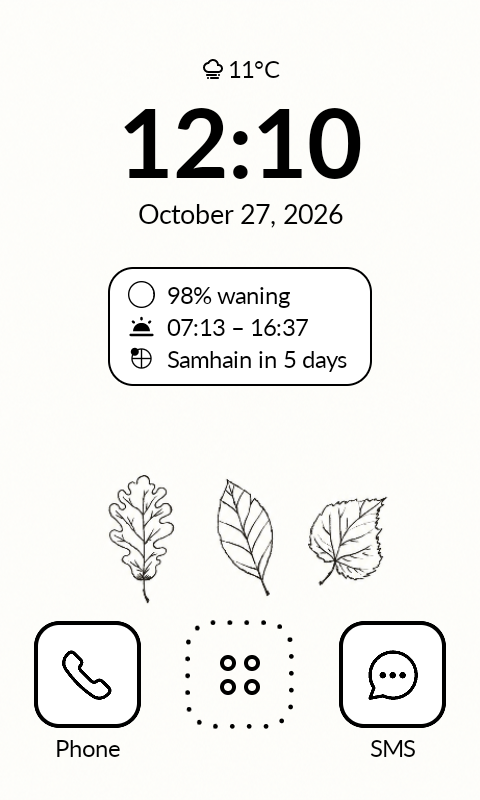
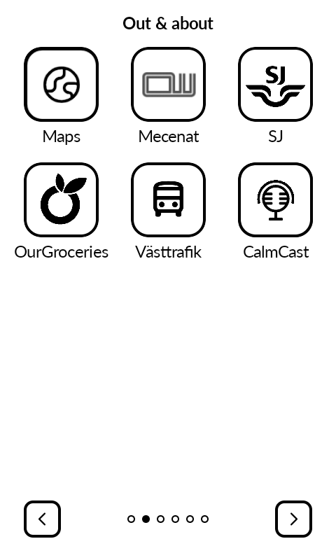
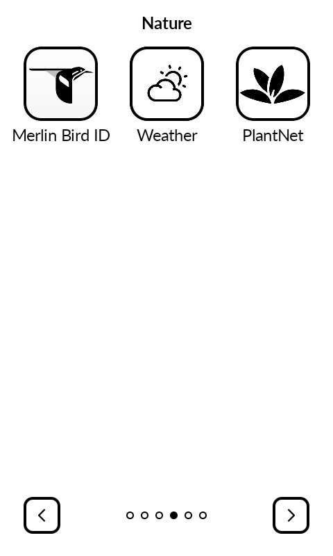
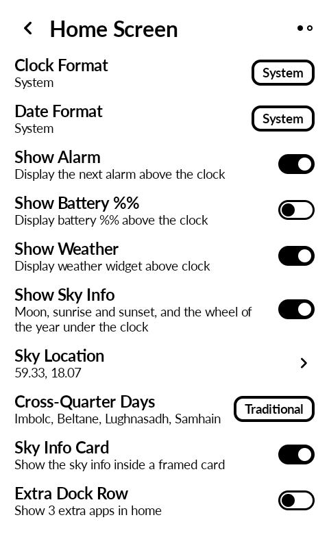

# Katapult with sky info and app pages

This is a fork of [Katapult](https://github.com/gezimos/Katapult) by gezimos, a simple grid launcher for the Mudita Kompakt e-ink phone. It's my personal version and keeps everything from the original. It adds two things: sky info under the clock, and more control over how apps are arranged into pages.

The original README follows further down.

<div align="center">
    <table>
        <tr>
            <td></td>
            <td></td>
            <td></td>
            <td></td>
        </tr>
    </table>
</div>

## What's different in this fork

### Sky info under the clock

Three short lines under the clock, on both the home screen and the screensaver:

```
(moon)  62% waning
(sun)   07:58 – 17:32
Samhain in 9 days
```

- **Moon phase:** a small moon drawn in solid black and white (no grey, so it stays crisp on e-ink), with how much of the moon is lit and whether it's waxing or waning.
- **Sunrise and sunset** for today, in the phone's time zone. On days when the sun never sets or never rises, the line says "Midnight sun" or "Polar night".
- **The next point in the wheel of the year:** the solstices and equinoxes, plus the Celtic cross-quarter days Imbolc, Beltane, Lughnasadh and Samhain. It says "today" or "tomorrow" when it's that close.

Settings (long-press an empty area of the home screen):

- **Show Sky Info:** off by default.
- **Sky Location:** type the latitude and longitude (both `59.33` and `59,33` work), or tap "Use my current location". The phone then takes a single position fix and saves it rounded to about 1 km. There's no background location tracking and no Google services are needed.
- **Cross-Quarter Days:** _Traditional_ (1 Feb, 1 May, 1 Aug, 1 Nov), _Astronomical_ (the day the sun is exactly halfway between a solstice and an equinox, a few days later), or _Hidden_.
- **Sky Info Card:** optionally show the lines inside a framed card.

Everything is calculated on the phone, offline, once a day. The calculations live in their own module, [`astro/`](astro/), written in plain Kotlin with no Android code. They use the NOAA sunrise/sunset algorithm and Jean Meeus' _Astronomical Algorithms_, and unit tests check the results against timeanddate.com. Sky info is designed for the northern hemisphere.

### App pages with titles

Apps can be arranged into pages of your own. Choose _Custom_ under Settings → Order Apps. The other choices (_Alphabetical_, _Most Recent_, _Most Used_) sort the apps automatically, and your custom layout is kept for when you switch back.

- **Reorder** now also lets you move an app to an empty slot, not just swap two apps.
- **Start new page here** (long-press an app) starts a new page with that app.
- **Page titles:** give a page a name, for example "Travel" or "Tools".
- **Move page earlier / later:** long-press a page title to move the whole page.
- "Reset app order to alphabetical" also removes all page breaks.

### Update checker

Settings → Check for Updates only _tells_ you when the original Katapult has a new release. It doesn't download anything, since installing the official APK would replace this version.

## Installing

There are no ready-made downloads. Build it yourself with JDK 21 and the Android SDK:

```
./gradlew assembleDebug
adb install -r app/build/outputs/apk/debug/katapult-v1.6-debug.apk
```

It installs as its own app, "Katapult Debug", so it can sit next to the original Katapult. Choose it as the Home app in the phone's settings.

> [!TIP]
> If you use any app with fraud protection, leave "Katapult Action Service" turned off in Settings → Accessibility. While any accessibility service is on, some apps refuses to start. This applies to the original Katapult too. The service is only needed for the lock screen widgets, hiding the status bar clock, and locking the phone from the screensaver.

## License and credits

All credit for Katapult itself goes to [gezimos](https://github.com/gezimos). If you like the launcher, consider supporting the original project (link below). Like the original, this fork is licensed under the [GPL-3.0](LICENSE).

---

<div align="center">
	
	&nbsp;&nbsp;&nbsp;&nbsp;&nbsp;&nbsp;&nbsp;&nbsp;
	<a href="https://buymeacoffee.com/gezimos"></a>
	<h2>Katapult — A simple grid launcher for Mudita Kompakt</h2>
</div>

> [!NOTE]
> To install, download the latest APK from [Releases](https://github.com/gezimos/Katapult/releases) and install it on your device using Mudita Center or ADB/webADB.

<div align="center">
    <table>
        <tr>
            <td></td>
            <td></td>
            <td></td>
            <td></td>
        </tr>
        <tr>
            <td></td>
            <td></td>
            <td></td>
            <td></td>
        </tr>
    </table>
</div>

## Setup

- **Settings**: Long-press on any empty area of the home screen
- **Replace home apps**: Long-press on the Phone, SMS, or extra row shortcuts
- **Clock/Date shortcut**: Long-press on the clock or date to assign an app

## Features

- **3x4 app grid** tap on chevrons or use horizontal swipes
- **Music widget** with playback controls and song info, works with other third-party apps like Auxio, Fossify Music, Spotify, Foobar, CalmCast, Antenna Pod etc.
- **Icon tinting and shaping** for a uniform black & white look (works with ~95% of apps)
- **Icon shape**: Circle or Rounded, affects all icons, buttons, and indicators
- **Extra dock row**: 3 additional shortcuts above the Phone/SMS bar
- **Notification indicators** on app icons (requires notification listener permission)
- **Show battery %** with level-based icon above the clock.
- **Show AM/PM** for 12-hour clocks
- **Hide status bar** for a cleaner look
- **E-Ink refresh on home**: flashes the screen when pressing the home button to clear ghosting
- **Double-tap brightness**: toggle display brightness by double-tapping the home background (requires system settings permission)
- **Infinite scroll**: wrap around from last page to first
- **Simple wallpaper**: set a background image (not managed by Android)
- **Hide apps**: from the app context menu or bulk-hide from the home menu
- **Rename apps**: long-press any app in the grid
- **App context menu**: Reorder, Rename, Hide, App Info, Uninstall
- **Reorder apps**: swap-based reordering from the context menu, with reset to alphabetical option
- **Lockscreen Notifications (experimental)**: per-app notification counts on the lock screen, with an app allowlist and sort order. Long-press the widget to move/resize it, tap to save.
- **Screensaver (experimental)**: a Katapult screen saver showing the home clock, date, alarm, battery, and up to 4 notification rows. Start it with a two-finger long-press on the home screen (or the home long-press menu); the power button exits. Select Katapult once in system Screen saver settings (Settings → Experimental → Screensaver opens it).

## Permissions

| Permission                           | Why                                                                                                                                                                                                                                                                                                                                                             |
| ------------------------------------ | --------------------------------------------------------------------------------------------------------------------------------------------------------------------------------------------------------------------------------------------------------------------------------------------------------------------------------------------------------------- |
| `QUERY_ALL_PACKAGES`                 | List all installed apps                                                                                                                                                                                                                                                                                                                                         |
| `WRITE_SETTINGS`                     | Double-tap brightness toggle                                                                                                                                                                                                                                                                                                                                    |
| `REQUEST_DELETE_PACKAGES`            | Uninstall apps from the context menu                                                                                                                                                                                                                                                                                                                            |
| `BIND_NOTIFICATION_LISTENER_SERVICE` | Read notifications for badge counts                                                                                                                                                                                                                                                                                                                             |
| `READ_CALL_LOG`                      | Missed call badge on Mudita Phone (Mudita Kompakt only)                                                                                                                                                                                                                                                                                                         |
| `READ_SMS`                           | Unread SMS badge on Mudita Messages (Mudita Kompakt only)                                                                                                                                                                                                                                                                                                       |
| `BIND_ACCESSIBILITY_SERVICE`         | Draws the experimental lockscreen widget over the lock screen — an accessibility overlay is the only way a normal app can display there. The permission sounds scary, but Katapult reads only the lock screen itself — never your apps — so the widget can hide when the PIN screen appears. It records and shares nothing; this open source code is the proof. |

## FAQ

| Question                                                       | Answer                                                                                 |
| -------------------------------------------------------------- | -------------------------------------------------------------------------------------- |
| Will it have customizable fonts?                               | No.                                                                                    |
| Will it have a customizable grid?                              | No.                                                                                    |
| Will it have third-party icon packs?                           | No.                                                                                    |
| Will it get as many features as inkOS?                         | No.                                                                                    |
| Can I add more apps to the home screen?                        | No.                                                                                    |
| Can I adjust the opacity of the wallpaper?                     | No.                                                                                    |
| Can I change date/clock formats?                               | No. It follows Android settings. Change it there.                                      |
| Can I add AM/PM to a 12-hour clock?                            | Yes. It's in the settings.                                                             |
| Can I reorder apps?                                            | Yes. Long-press an app, tap Reorder, then tap another app to swap. Tap Save when done. |
| Will this launcher have a notification tray or letters screen? | No.                                                                                    |

## Troubleshooting

### Notification indicator not showing

Go to Settings > Notification Log and check if the notification exists in Android. Many apps require Google Play Services for push notifications. If it's not in the log, it doesn't exist for Android and Katapult can't read it.

### Notification not clearing

Check the Notification Log. If Android doesn't clear it, Katapult can't either.

### How to disable notification dots for a specific app

There are no allowlists. Go to Settings > App Notifications, tap the app, and disable "Allow notification dot".

## Support the project

<table><tr>
<td><a href="https://buymeacoffee.com/gezimos"></a></td>
<td valign="middle">Katapult is free, open source, and ad-free forever. If it's made your phone better, consider supporting development.</td>
</tr></table>

## Acknowledgments

- The experimental lockscreen widget's approach — drawing over the keyguard through an accessibility overlay — was inspired by [Lockscreen Widgets](https://github.com/zacharee/LockscreenWidgets) by Zachary Wander. Katapult's implementation is its own; no code was copied.
